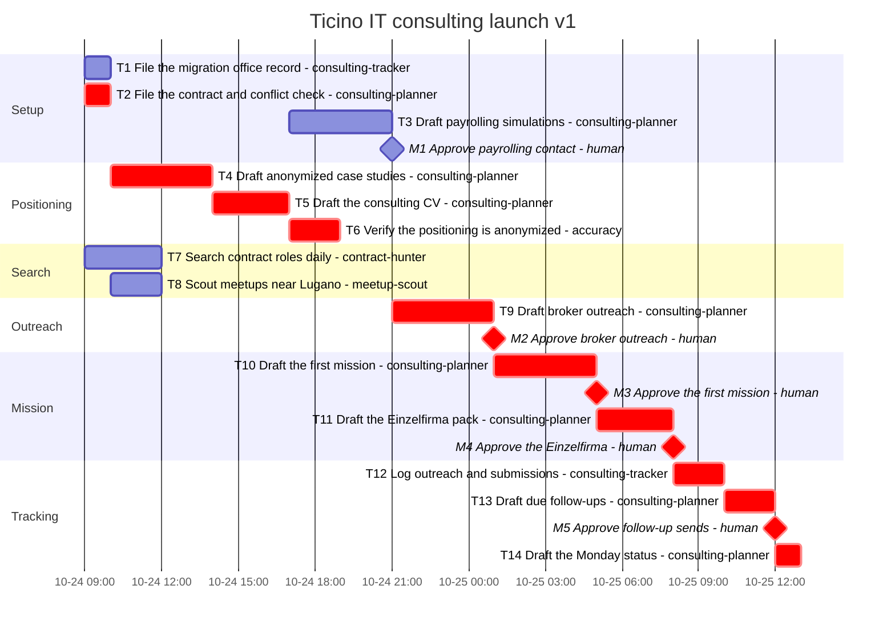

# Gantt

Generated from `plan.yaml` by `python -m planner gantt`. Do not edit by hand.

- Plan: swiss-consulting-2026-10 v1
- Origin: 2026-10-24T09:00:00+02:00
- CPM duration: 26h (std dev 0.9718h along the critical path)
- Resource-constrained makespan: 28h
- Critical path: T2, T4, T5, T6, T9, M2, T10, M3, T11, M4, T12, T13, M5, T14
- `crit` means unconstrained CPM slack is zero. Bar times are the resource-constrained schedule.

| ID | Start | Finish | Slack | Assignee | Critical |
| --- | --- | --- | --- | --- | --- |
| T1 | 0 | 1 | 20 | consulting-tracker | no |
| T2 | 0 | 1 | 0 | consulting-planner | yes |
| T7 | 0 | 3 | 7 | contract-hunter | no |
| T4 | 1 | 5 | 0 | consulting-planner | yes |
| T8 | 1 | 3 | 23 | meetup-scout | no |
| T5 | 5 | 8 | 0 | consulting-planner | yes |
| T3 | 8 | 12 | 9 | consulting-planner | no |
| T6 | 8 | 10 | 0 | accuracy | yes |
| M1 | 12 | 12 | 9 | human | no |
| T9 | 12 | 16 | 0 | consulting-planner | yes |
| M2 | 16 | 16 | 0 | human | yes |
| T10 | 16 | 20 | 0 | consulting-planner | yes |
| M3 | 20 | 20 | 0 | human | yes |
| T11 | 20 | 23 | 0 | consulting-planner | yes |
| M4 | 23 | 23 | 0 | human | yes |
| T12 | 23 | 25 | 0 | consulting-tracker | yes |
| T13 | 25 | 27 | 0 | consulting-planner | yes |
| M5 | 27 | 27 | 0 | human | yes |
| T14 | 27 | 28 | 0 | consulting-planner | yes |

